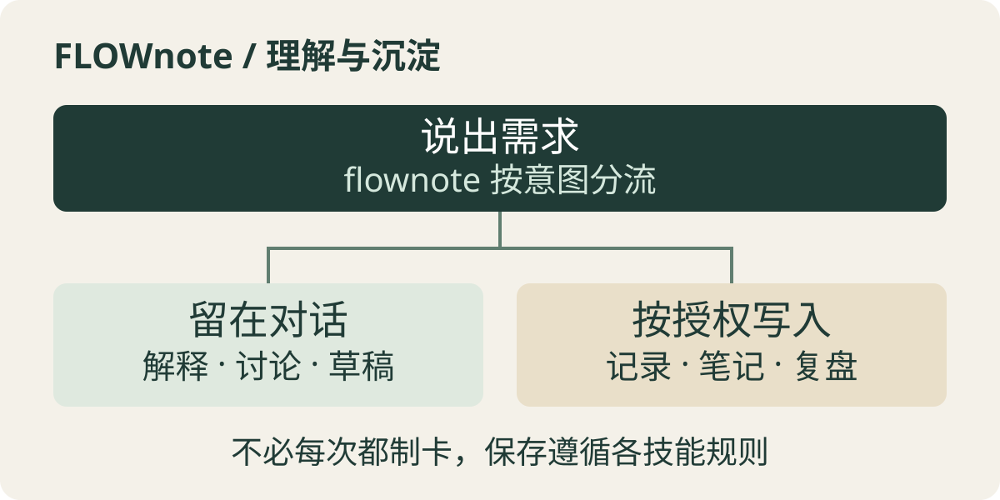

# FLOWnote Skills

让 Agent 在你的 Obsidian 知识库里帮你记录想法、读懂材料、整理笔记和复盘进展。这是包含 19 个技能的工作流合集，不是 Obsidian 插件，也不替你决定什么值得保存。

先在测试知识库中试用：[安装与运行说明](docs/installation.md)。

## 已经验证了什么

当前为早期预览版。三个会话读取器的 **31 项合成测试通过**；在隔离的模拟知识库中，验证了初始化、灵感与任务分流、阅读先分析后保存，以及复盘和对话沉淀的独立产物。

Claude Code 的新会话已验证能发现入口，但这不等于所有 Agent 的自动路由都已通过。完整证据与未验证范围见[验收记录](docs/validation.md)。

## 不必记住 19 个技能名

你向 `flownote` 说出需求，它按意图找到对应技能。记录想法、分析材料、整理任务分别处理；读懂一篇文章可以停在对话里，不必每次都生成一张卡片。

<p align="center">
  
</p>

例如，你可以先说“帮我读懂这篇文章，先不保存”，讨论后再决定是否留下结构化笔记。任务复盘关注进展与证据；对话沉淀保留有价值的交流，不把两者混成同一种记录。

## 从一个测试知识库开始

安装后，你可以对 Agent 说：

> 用 flownote 初始化这个测试知识库。先检查已有文件，再跟我确认需要创建的内容。

先获取技能与配套文件：

```bash
git clone https://github.com/Jhyphlau/flownote-skills.git
```

克隆不等于激活。按[安装说明](docs/installation.md)把 `skills/` 中的 19 个目录放到测试知识库的 `.flownote/skills/`，再配置宿主入口。会话读取器只在复盘或沉淀会话时需要，不是日常记录的前置条件。

## 使用前知道这些边界

### 需要能读写文件的 Agent

这套技能是指令与模板，不是独立应用。Agent 需要获准访问知识库；首次使用保留默认中文目录结构。已有知识库先备份，不要直接覆盖模板或入口。

### 没被发现，就不会自动分流

不同 Agent 的入口配置不同。目前仅验证了一个 Claude Code 入口的发现；其他宿主需要自行配置并验证，不承诺装上即用。

### 会话导出不等于脱敏

会话来源必须由你配置并授权，读取器按 UTC+8 的消息日期取材，不自动搜索整台电脑。导出的真实对话仍可能含个人信息或密钥，不要直接公开。

### 外围工具需要另行准备

会话读取脚本需要 Python 3。Obsidian CLI 和 Dataview 是可选能力；OCR、绘图、下载工具不在这个合集里。缺少可读材料时，需要先准备材料，而不是让 Agent 猜测内容。

## 深入阅读

- [安装与运行说明](docs/installation.md)：文件放在哪里、入口怎么接、外部能力缺失时如何处理。
- [会话指针示例](examples/session-pointers.example.md)：配置本机日志来源及客户端共享路径的边界。
- [验收记录](docs/validation.md)：区分合成测试、模拟旅程和真实宿主发现。
- [公开范围](docs/public-scope.md)：哪些文件被纳入，以及做过哪些通用化适配。
- [来源登记](SOURCES.md)与[第三方通知](NOTICE.md)：固定上游版本、改编来源和版权声明。

技能体系参照并改编自[阿浩learn 的 FLOWnote](https://github.com/1095327780/FLOWnote)，在原 `ah` 系列基础上扩展和整理。`flownote-explain`、`flownote-paper` 另改编自 [lijigang/ljg-skills](https://github.com/lijigang/ljg-skills)。本仓库由 Jhyphlau 维护，是独立改编版本，不代表上游官方发布，也不将改编内容称为全部原创。

许可证：[MIT](LICENSE)。再分发时请保留上游署名与许可通知。
